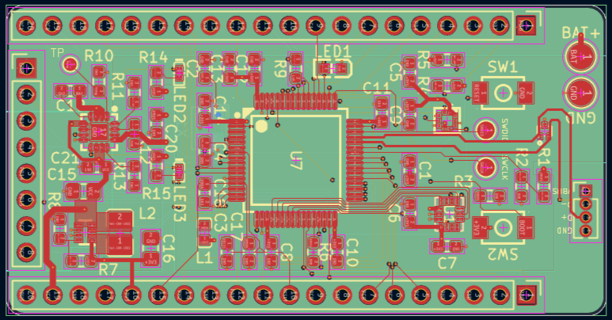
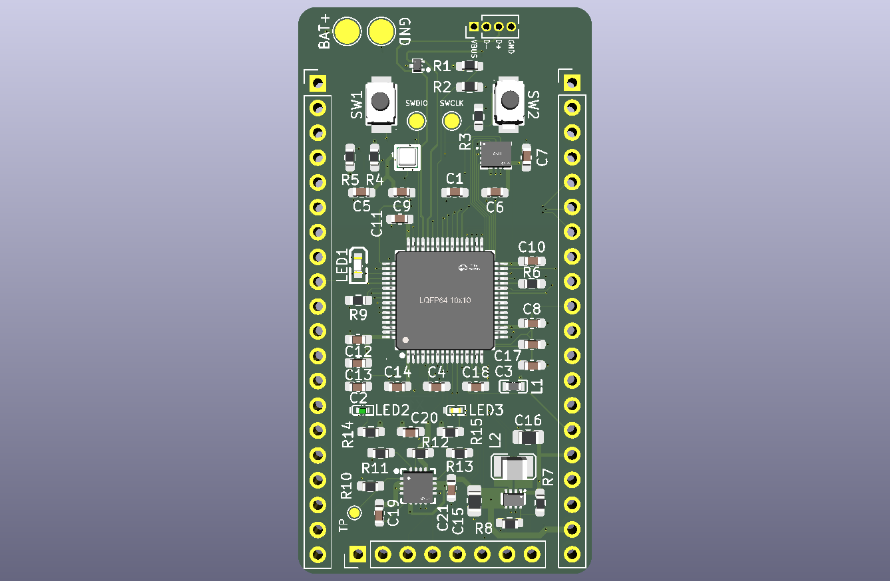

# AT32F435 - Black Panther

<h4>This is my most favorate Microcontroller, hence I wanted to design & build a compact, cute, powerful packed Dev Board. 

It features crucial sensors like ICM-42688-P for 6 axis Gyroscope, BMP581 for Barometric Pressure.

Can be used in wide variety of projects, powerful enough.
From being a custom microcontroller turned into a Flight controller, Can be used for Telemetry, IoT devices, Automation, etc...</h4>

## Layout

6 Layer PCB 4 mil / 4mil 

Stack:
Signal
Ground
Power
Ground
Signal

Consists 79 nets with 263 Pads, 142 Vias, 544 Track Segments

## Gallery
 

## Bill of Materials

| # | LCSC | MPN | Manufacturer | Package | Description | Qty | Unit Price | Extended Price |
|---:|---|---|---|---|---|---:|---:|---:|
| 1 | [C2933206](https://www.lcsc.com/product-detail/C2933206.html) | FRC0603F3571TS | FOJAN | 0603 | 3.57kΩ ±1% 100mW 0603 Thick Film Resistor | 100 | $0.0012 | $0.12 |
| 2 | [C2682775](https://www.lcsc.com/product-detail/C2682775.html) | X32258MOB4SI | YXC Crystal Oscillators | SMD3225-4P | Crystal 8MHz ±10ppm 12pF 150Ω SMD3225-4P | 5 | $0.1993 | $1.00 |
| 3 | [C3029577](https://www.lcsc.com/product-detail/C3029577.html) | AT32F435RGT7 | ARTERY | LQFP-64(10x10) | ARM Cortex-M4 32 Bit 288MHz LQFP-64(10x10) Microcontrollers | 1 | $4.3654 | $4.37 |
| 4 | [C140288](https://www.lcsc.com/product-detail/C140288.html) | BQ24072RGTR | TI | QFN-16-EP(3x3) | 4.35V~6.6V Lithium Battery 1 1.5A QFN-16-EP(3x3) Battery Chargers RoHS | 1 | $1.0593 | $1.06 |
| 5 | [C882955](https://www.lcsc.com/product-detail/C882955.html) | DFE252012P-1R0M=P2 | muRata | 1008 | 4.3A 1uH ±20% 42mΩ 4.3A 1008 Fixed Inductors RoHS | 5 | $0.1244 | $0.62 |
| 6 | [C5219190](https://www.lcsc.com/product-detail/C5219190.html) | TPS631000DRLR | TI | SOT-583 | Buck-Boost Switching Regulator IC Adjustable 1.2V~5.3V 2A SOT-583 | 1 | $0.4560 | $0.46 |
| 7 | [C5182099](https://www.lcsc.com/product-detail/C5182099.html) | TPD2EUSB30DRTR | TECH PUBLIC | SOT(9x3) | 18VC Clamp TVS DIODE SOT(9x3) | 5 | $0.1979 | $0.99 |
| 8 | [C5362283](https://www.lcsc.com/product-detail/C5362283.html) | BMP581 | Bosch | LGA-10(2x2) | 30Kpa~1.25bar LGA-10(2x2) Pressure Sensors, Transducers RoHS | 1 | $2.3423 | $2.34 |
| 9 | [C1850418](https://www.lcsc.com/product-detail/C1850418.html) | ICM-42688-P | TDK InvenSense | LGA-14(2.5x3) | LGA-14(2.5x3) IMUs (Inertial Measurement Units) RoHS | 1 | $25.8192 | $25.82 |
| 10 | [C55073343](https://www.lcsc.com/product-detail/C55073343.html) | HX 3x4x2-2P-1.6N-04 | hanxia | SMD,4x3mm | 4mm 1.6N 12V 3mm Round Button SPST 50mA SMD Tactile Switch | 20 | $0.0274 | $0.55 |
| 11 | [C5602400](https://www.lcsc.com/product-detail/C5602400.html) | CR16330J | Meritek | 0603 | 33Ω 100mW Thick Film Resistor ±100ppm/℃ ±5% 0603 Chip Resistor | 1 | $0.0036 | $0.01 |
| 12 | [C2907077](https://www.lcsc.com/product-detail/C2907077.html) | FRC0603F9102TS | FOJAN | 0603 | 91kΩ ±1% 100mW 0603 Thick Film Resistor | 100 | $0.0016 | $0.16 |
| 13 | [C861454](https://www.lcsc.com/product-detail/C861454.html) | RT0603BRD07511KL | YAGEO | 0603 | 511kΩ 100mW 75V Thin Film Resistor ±25ppm/℃ ±0.1% 0603 Chip Resistor | 20 | $0.0396 | $0.79 |
| 14 | [C99782](https://www.lcsc.com/product-detail/C99782.html) | RC0603FR-074K7L | YAGEO | 0603 | 100mW 4.7kΩ 75V Thick Film Resistor ±100ppm/℃ ±1% 0603 Chip Resistor | 100 | $0.0032 | $0.32 |
| 15 | [C14675](https://www.lcsc.com/product-detail/C14675.html) | RC0603FR-07100KL | YAGEO | 0603 | 100mW 100kΩ 75V Thick Film Resistor ±100ppm/℃ ±1% 0603 Chip Resistor | 100 | $0.0021 | $0.21 |
| 16 | [C22548](https://www.lcsc.com/product-detail/C22548.html) | RC0603FR-071KL | YAGEO | 0603 | 100mW 1kΩ 75V Thick Film Resistor ±100ppm/℃ ±1% 0603 Chip Resistor | 100 | $0.0036 | $0.36 |
| 17 | [C1705](https://www.lcsc.com/product-detail/C1705.html) | CL10A475KP8NNNC | Samsung Electro-Mechanics | 0603 | 4.7uF ±10% 10V Ceramic Capacitor X5R 0603 | 50 | $0.0128 | $0.64 |
| 18 | [C114662](https://www.lcsc.com/product-detail/C114662.html) | RC0603FR-072K2L | YAGEO | 0603 | 100mW 2.2kΩ 75V Thick Film Resistor ±100ppm/℃ ±1% 0603 Chip Resistor | 100 | $0.0019 | $0.19 |
| 19 | [C98220](https://www.lcsc.com/product-detail/C98220.html) | RC0603FR-0710KL | YAGEO | 0603 | 100mW 10kΩ 75V Thick Film Resistor ±100ppm/℃ ±1% 0603 Chip Resistor | 100 | $0.0023 | $0.23 |
| 20 | [C2907053](https://www.lcsc.com/product-detail/C2907053.html) | FRC0603F5602TS | FOJAN | 0603 | 56kΩ ±1% 100mW 0603 Thick Film Resistor | 100 | $0.0018 | $0.18 |
| 21 | [C22355736](https://www.lcsc.com/product-detail/C22355736.html) | XL-1005UBC | XINGLIGHT | 0402 | Blue 465nm LED Indication - Discrete 3.3V 0402 | 50 | $0.0081 | $0.41 |
| 22 | [C965793](https://www.lcsc.com/product-detail/C965793.html) | XL-1005UGC | XINGLIGHT | 0402 | Emerald Green 531nm LED Indication - Discrete 3V 0402 | 50 | $0.0090 | $0.45 |
| 23 | [C434424](https://www.lcsc.com/product-detail/C434424.html) | SZYY0603Y | Yongyu Photoelectric | 0603 | Yellow 596nm LED Indication - Discrete 2.4V 0603 | 50 | $0.0150 | $0.75 |
| 24 | [C14709](https://www.lcsc.com/product-detail/C14709.html) | BLM18PG121SN1D | muRata | 0603 | 120Ω@100MHz 1 Line Ferrite Bead 0603 2A 50mΩ | 50 | $0.0142 | $0.71 |
| 25 | [C2691448](https://www.lcsc.com/product-detail/C2691448.html) | PZ254V-11-04P | XFCN | Through Hole,P=2.54mm | Pin Header 4 Position 2.54mm Pitch Single Row Through Hole -40℃~+105℃ | 20 | $0.0263 | $0.53 |
| 26 | [C492407](https://www.lcsc.com/product-detail/C492407.html) | PZ254V-11-08P | XFCN | Through Hole,P=2.54mm | Pin Header 8 Position 2.54mm Pitch Single Row Through Hole -40℃~+105℃ | 10 | $0.0491 | $0.49 |
| 27 | [C42431804](https://www.lcsc.com/product-detail/C42431804.html) | PH2.54-1X20P-H25 | JXTCONN | Through Hole,P=2.54mm | Pin Header 20 Position 2.54mm Pitch Single Row Through Hole -40℃~+105℃ | 5 | $0.0856 | $0.43 |
| 28 | [C23630](https://www.lcsc.com/product-detail/C23630.html) | CL10A225KO8NNNC | Samsung Electro-Mechanics | 0603 | 2.2uF ±10% 16V Ceramic Capacitor X5R 0603 | 50 | $0.0101 | $0.51 |
| 29 | [C1644](https://www.lcsc.com/product-detail/C1644.html) | CL10C150JB8NNNC | Samsung Electro-Mechanics | 0603 | 15pF ±5% 50V Ceramic Capacitor C0G 0603 | 50 | $0.0112 | $0.56 |
| 30 | [C5199872](https://www.lcsc.com/product-detail/C5199872.html) | CL10B105KB8NQNC | Samsung Electro-Mechanics | 0603 | 1uF ±10% 50V Ceramic Capacitor X7R 0603 | 20 | $0.0189 | $0.38 |
| 31 | [C16780](https://www.lcsc.com/product-detail/C16780.html) | CL21A476MQYNNNE | Samsung Electro-Mechanics | 0805 | 47uF ±20% 6.3V Ceramic Capacitor X5R 0805 | 10 | $0.0750 | $0.75 |
| 32 | [C602037](https://www.lcsc.com/product-detail/C602037.html) | CL21A226MAYNNNE | Samsung Electro-Mechanics | 0805 | 22uF ±20% 25V Ceramic Capacitor X5R 0805 | 10 | $0.1077 | $1.08 |
|  |  |  |  |  | **Total** |  |  | **$124.59** |

## Notes
- Production / Fabrication files are inside `/production/`
- PCB files under `/PCB/`
- Datasheets under `/docs/`
- Bill of Material under `/BOM.csv`

## License
[MIT](/LICENSE)

Happy [Fabricating](https://fabricate.hackclub.com) ;D
