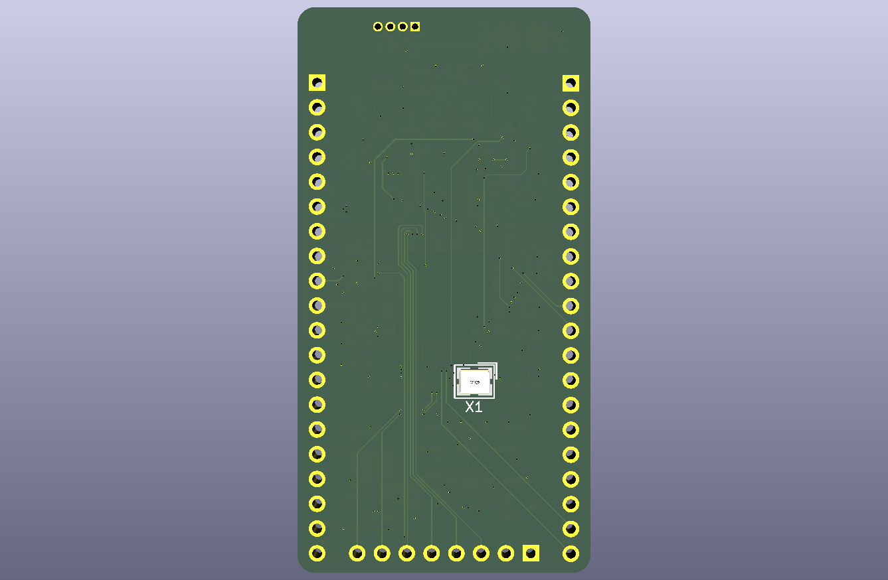

# AT32F435 - Black Panther

<h4>This is my most favorate Microcontroller, hence I wanted to design & build a compact, cute, powerful packed Dev Board. 

It features crucial sensors like ICM-42688-P for 6 axis Gyroscope, BMP581 for Barometric Pressure.

Can be used in wide variety of projects, powerful enough.
From being a custom microcontroller turned into a Flight controller, Can be used for Telemetry, IoT devices, Automation, etc...</h4>

## Layout

6 Layer PCB 4 mil / 4mil 

Stack:
Signal
Ground
Power
Ground
Signal

Consists 79 nets with 263 Pads, 142 Vias, 544 Track Segments

## Gallery
 

## Bill of Materials

| # | Item / MPN | Type | Vendor | Package | Qty | Unit Price | Line Total | Funding |
|---:|---|---|---|---|---:|---:|---:|---|
| 1 | [FRC0603F3571TS](https://www.lcsc.com/product-detail/C2933206.html) — 3.57kΩ ±1% 100mW 0603 Thick Film Resistor | Part | FOJAN | 0603 | 100 | $0.0012 | $0.12 | Grant |
| 2 | [X32258MOB4SI](https://www.lcsc.com/product-detail/C2682775.html) — Crystal 8MHz ±10ppm 12pF 150Ω SMD3225-4P | Part | YXC Crystal Oscillators | SMD3225-4P | 5 | $0.1993 | $1.00 | Grant |
| 3 | [AT32F435RGT7](https://www.lcsc.com/product-detail/C3029577.html) — ARM Cortex-M4 32 Bit 288MHz LQFP-64(10x10) Microcontrollers | Part | ARTERY | LQFP-64(10x10) | 1 | $4.3654 | $4.37 | Already own |
| 4 | [BQ24072RGTR](https://www.lcsc.com/product-detail/C140288.html) — 4.35V~6.6V Lithium Battery 1 1.5A QFN-16-EP(3x3) Battery Chargers RoHS | Part | TI | QFN-16-EP(3x3) | 1 | $1.0593 | $1.06 | Grant |
| 5 | [DFE252012P-1R0M=P2](https://www.lcsc.com/product-detail/C882955.html) — 4.3A 1uH ±20% 42mΩ 4.3A 1008 Fixed Inductors RoHS | Part | muRata | 1008 | 5 | $0.1244 | $0.62 | Grant |
| 6 | [TPS631000DRLR](https://www.lcsc.com/product-detail/C5219190.html) — Buck-Boost Switching Regulator IC Adjustable 1.2V~5.3V 2A SOT-583 | Part | TI | SOT-583 | 1 | $0.4560 | $0.46 | Grant |
| 7 | [TPD2EUSB30DRTR](https://www.lcsc.com/product-detail/C5182099.html) — 18VC Clamp TVS DIODE SOT(9x3) | Part | TECH PUBLIC | SOT(9x3) | 5 | $0.1979 | $0.99 | Grant |
| 8 | [BMP581](https://www.lcsc.com/product-detail/C5362283.html) — 30Kpa~1.25bar LGA-10(2x2) Pressure Sensors, Transducers RoHS | Part | Bosch | LGA-10(2x2) | 1 | $2.3423 | $2.34 | Grant |
| 9 | [ICM-42688-P](https://www.lcsc.com/product-detail/C1850418.html) — LGA-14(2.5x3) IMUs (Inertial Measurement Units) RoHS | Part | TDK InvenSense | LGA-14(2.5x3) | 1 | $25.8192 | $25.82 | Grant |
| 10 | [HX 3x4x2-2P-1.6N-04](https://www.lcsc.com/product-detail/C55073343.html) — 4mm 1.6N 12V 3mm Round Button SPST 50mA SMD Tactile Switch | Part | hanxia | SMD,4x3mm | 20 | $0.0274 | $0.55 | Grant |
| 11 | [CR16330J](https://www.lcsc.com/product-detail/C5602400.html) — 33Ω 100mW Thick Film Resistor ±100ppm/℃ ±5% 0603 Chip Resistor | Part | Meritek | 0603 | 1 | $0.0036 | $0.01 | Grant |
| 12 | [FRC0603F9102TS](https://www.lcsc.com/product-detail/C2907077.html) — 91kΩ ±1% 100mW 0603 Thick Film Resistor | Part | FOJAN | 0603 | 100 | $0.0016 | $0.16 | Grant |
| 13 | [RT0603BRD07511KL](https://www.lcsc.com/product-detail/C861454.html) — 511kΩ 100mW 75V Thin Film Resistor ±25ppm/℃ ±0.1% 0603 Chip Resistor | Part | YAGEO | 0603 | 20 | $0.0396 | $0.79 | Grant |
| 14 | [RC0603FR-074K7L](https://www.lcsc.com/product-detail/C99782.html) — 100mW 4.7kΩ 75V Thick Film Resistor ±100ppm/℃ ±1% 0603 Chip Resistor | Part | YAGEO | 0603 | 100 | $0.0032 | $0.32 | Grant |
| 15 | [RC0603FR-07100KL](https://www.lcsc.com/product-detail/C14675.html) — 100mW 100kΩ 75V Thick Film Resistor ±100ppm/℃ ±1% 0603 Chip Resistor | Part | YAGEO | 0603 | 100 | $0.0021 | $0.21 | Grant |
| 16 | [RC0603FR-071KL](https://www.lcsc.com/product-detail/C22548.html) — 100mW 1kΩ 75V Thick Film Resistor ±100ppm/℃ ±1% 0603 Chip Resistor | Part | YAGEO | 0603 | 100 | $0.0036 | $0.36 | Grant |
| 17 | [CL10A475KP8NNNC](https://www.lcsc.com/product-detail/C1705.html) — 4.7uF ±10% 10V Ceramic Capacitor X5R 0603 | Part | Samsung Electro-Mechanics | 0603 | 50 | $0.0128 | $0.64 | Grant |
| 18 | [RC0603FR-072K2L](https://www.lcsc.com/product-detail/C114662.html) — 100mW 2.2kΩ 75V Thick Film Resistor ±100ppm/℃ ±1% 0603 Chip Resistor | Part | YAGEO | 0603 | 100 | $0.0019 | $0.19 | Grant |
| 19 | [RC0603FR-0710KL](https://www.lcsc.com/product-detail/C98220.html) — 100mW 10kΩ 75V Thick Film Resistor ±100ppm/℃ ±1% 0603 Chip Resistor | Part | YAGEO | 0603 | 100 | $0.0023 | $0.23 | Grant |
| 20 | [FRC0603F5602TS](https://www.lcsc.com/product-detail/C2907053.html) — 56kΩ ±1% 100mW 0603 Thick Film Resistor | Part | FOJAN | 0603 | 100 | $0.0018 | $0.18 | Grant |
| 21 | [XL-1005UBC](https://www.lcsc.com/product-detail/C22355736.html) — Blue 465nm LED Indication - Discrete 3.3V 0402 | Part | XINGLIGHT | 0402 | 50 | $0.0081 | $0.41 | Grant |
| 22 | [XL-1005UGC](https://www.lcsc.com/product-detail/C965793.html) — Emerald Green 531nm LED Indication - Discrete 3V 0402 | Part | XINGLIGHT | 0402 | 50 | $0.0090 | $0.45 | Grant |
| 23 | [SZYY0603Y](https://www.lcsc.com/product-detail/C434424.html) — Yellow 596nm LED Indication - Discrete 2.4V 0603 | Part | Yongyu Photoelectric | 0603 | 50 | $0.0150 | $0.75 | Grant |
| 24 | [BLM18PG121SN1D](https://www.lcsc.com/product-detail/C14709.html) — 120Ω@100MHz 1 Line Ferrite Bead 0603 2A 50mΩ | Part | muRata | 0603 | 50 | $0.0142 | $0.71 | Grant |
| 25 | [PZ254V-11-04P](https://www.lcsc.com/product-detail/C2691448.html) — Pin Header 4 Position 2.54mm Pitch Single Row Through Hole -40℃~+105℃ | Part | XFCN | Through Hole,P=2.54mm | 20 | $0.0263 | $0.53 | Grant |
| 26 | [PZ254V-11-08P](https://www.lcsc.com/product-detail/C492407.html) — Pin Header 8 Position 2.54mm Pitch Single Row Through Hole -40℃~+105℃ | Part | XFCN | Through Hole,P=2.54mm | 10 | $0.0491 | $0.49 | Grant |
| 27 | [PH2.54-1X20P-H25](https://www.lcsc.com/product-detail/C42431804.html) — Pin Header 20 Position 2.54mm Pitch Single Row Through Hole -40℃~+105℃ | Part | JXTCONN | Through Hole,P=2.54mm | 5 | $0.0856 | $0.43 | Grant |
| 28 | [CL10A225KO8NNNC](https://www.lcsc.com/product-detail/C23630.html) — 2.2uF ±10% 16V Ceramic Capacitor X5R 0603 | Part | Samsung Electro-Mechanics | 0603 | 50 | $0.0101 | $0.51 | Grant |
| 29 | [CL10C150JB8NNNC](https://www.lcsc.com/product-detail/C1644.html) — 15pF ±5% 50V Ceramic Capacitor C0G 0603 | Part | Samsung Electro-Mechanics | 0603 | 50 | $0.0112 | $0.56 | Grant |
| 30 | [CL10B105KB8NQNC](https://www.lcsc.com/product-detail/C5199872.html) — 1uF ±10% 50V Ceramic Capacitor X7R 0603 | Part | Samsung Electro-Mechanics | 0603 | 20 | $0.0189 | $0.38 | Grant |
| 31 | [CL21A476MQYNNNE](https://www.lcsc.com/product-detail/C16780.html) — 47uF ±20% 6.3V Ceramic Capacitor X5R 0805 | Part | Samsung Electro-Mechanics | 0805 | 10 | $0.0750 | $0.75 | Grant |
| 32 | [CL21A226MAYNNNE](https://www.lcsc.com/product-detail/C602037.html) — 22uF ±20% 25V Ceramic Capacitor X5R 0805 | Part | Samsung Electro-Mechanics | 0805 | 10 | $0.1077 | $1.08 | Grant |
| 33 | [PCB](https://jlcpcb.com) | PCB | JLCPCB | — | 1 | $32.10 | $32.10 | Grant |
| 34 | [Stencil](https://jlcpcb.com) | PCB | JLCPCB | — | 1 | $7.22 | $7.22 | Grant |
| 35 | [Hot Plate](https://www.amazon.in/gp/product/B0C7W3W8C4/ref=ox_sc_act_title_1?smid=A2ON2B5XK3AL27&psc=1) | Part | Amazon | — | 1 | $33.18 | $33.18 | Grant |
| 36 | Shipping | Shipping | — | — | 1 | $8.99 | $8.99 | Grant |

**Overall total: $128.96**

**Grant total: $124.59**

## Notes
- Production / Fabrication files are inside `/production/`
- PCB files under `/PCB/`
- Datasheets under `/docs/`
- Bill of Material under `/BOM.csv`

## License
[MIT](/LICENSE)

Happy [Fabricating](https://fabricate.hackclub.com) ;D
